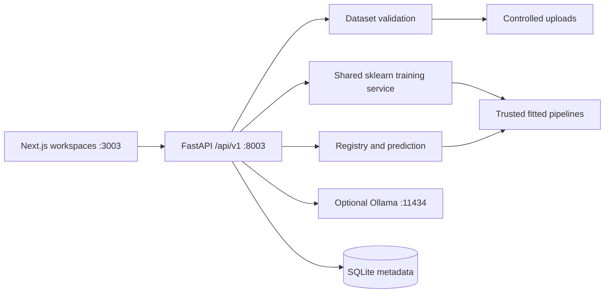

# Architecture

ModelForge is an independent, trusted-local, single-user workstation application. Next.js App Router serves the frontend at 127.0.0.1:3003. FastAPI serves a versioned HTTP API at 127.0.0.1:8003. No code, databases or ports are shared with other portfolio projects.

`backend/app/config.py` centralizes limits and storage. `db.py` defines Dataset, Experiment, RegisteredModel and PredictionRecord with UUID identifiers, foreign keys and timestamp/status indices. SQLAlchemy initializes missing tables without deleting existing data. A running experiment found at startup is recorded as interrupted/failed. Use one Uvicorn process; the training lock is process-local.

Routers separate dataset operations, training, persisted records and optional GenAI. The shared ML service owns tabular preprocessing, algorithm construction, evaluation and prediction validation. Focused branches implement K-Means, TF-IDF and the MLP baseline; all reuse persistence and artifact handling. There are no distributed queues or fabricated progress streams.

A synchronous training request commits a running record, reads the original dataset, executes training, saves a uniquely named fitted pipeline, and commits real metrics and warnings. Failures remain inspectable. Explicit registration makes a successful artifact available for prediction and export. Predictions are recorded after successful inference. Dataset deletion returns 409 when history references it.

The frontend uses a shared typed API client and reusable panels, tables, status badges and metric cards. The nine workspaces share one application shell. Training uses the request lifecycle as its busy state; it does not display simulated progress. Charts derive from persisted runs and selected evaluation metrics. Model detail views expose configuration, features and split fingerprints.

Default storage is `backend/data/{metadata.sqlite3,uploads/,artifacts/}`. Set `MODELFORGE_DATA_DIR` in the process environment before startup to change it. Keep metadata and artifacts together when backing up, with the app stopped. The development schema is initialized with `create_all`; structural schema changes require a reviewed migration. No migration framework or public deployment is included.

Main API groups: `/health`, `/settings`, `/dashboard`, `/datasets`, `/automl/train`, `/autonlp/train`, `/neural/train`, `/genai/status`, `/genai/generate`, `/experiments`, `/experiments/compare`, `/models`, `/models/{id}/predict`, `/models/{id}/export`, `/predictions`. Interactive schemas: http://localhost:8003/docs.
